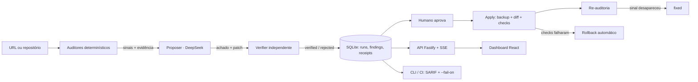

# AutoCorrecoes

[](https://github.com/Alexandre200-lab/autocorrecoes-site/actions/workflows/ci.yml)
[](https://github.com/Alexandre200-lab/autocorrecoes-site/actions/workflows/ai-eval.yml)
[](LICENSE)
[](https://nodejs.org/)

**Auditoria e autocorreção de sites com IA — sem confiar cegamente na IA.**

Ferramentas determinísticas encontram problemas de design, backend e código; o DeepSeek atua como fiscalizador; e nenhuma mudança chega ao repositório sem aprovação humana, backup e re-auditoria.

---

## 1. Visão geral

O sistema separa quatro decisões, cada uma com um dono diferente:

| Etapa | Quem decide | O que faz |
|---|---|---|
| **Coleta** | Ferramentas determinísticas | axe-core, Lighthouse, Playwright, checagens HTTP, lint, testes, `npm audit` e varredura estática produzem sinais com evidência. |
| **Proposta** | DeepSeek (`Proposer`) | Transforma sinais em achados e patches mínimos, com explicação do impacto. |
| **Verificação** | DeepSeek (`Verifier`) | Confirma ou rejeita cada proposta **sem ver o raciocínio de quem a criou**. |
| **Aprovação** | Pessoa | Aprova, rejeita ou pede revisão. Só então o patch é aplicado, com checks locais e re-auditoria. |

**Princípio norteador:** máquinas detectam, IA sugere, pessoas decidem riscos.

> Nada é aplicado sem aprovação. Patches que apenas escondem o sintoma — `aria-hidden`, `display:none`, `disableRules`, `eslint-disable`, desligamento de testes/CI — são bloqueados antes da revisão humana.

### Arquitetura



Componentes principais:

- **Fila durável** com worker, retry/backoff e dead-letter — auditorias sobrevivem a restart.
- **Eventos persistidos** com replay para SSE — reconectar não perde progresso.
- **Auth** por cookie httpOnly no dashboard e Bearer na CLI/CI.
- **Configuração por projeto** com `.autocorrecoes.yml`, baseline e agendamento.

---

## 2. Início rápido

### Requisitos

- **Node.js >= 22.5** (usa `node:sqlite` nativo)
- Chave da [DeepSeek Platform](https://platform.deepseek.com/api_keys)
- Chromium do Playwright (somente para auditoria de design)

### Instalação local

```bash
npm ci
cp .env.example .env
# preencha DEEPSEEK_API_KEY no .env

npx playwright install chromium
# Linux sem libs gráficas: npx playwright install-deps chromium

npm run cli -- doctor        # verifica configuração, banco e browser
```

Dashboard (build de produção):

```bash
npm --prefix dashboard ci
npm --prefix dashboard run build
npm start                    # API + dashboard em http://127.0.0.1:4310
```

### Docker

```bash
# API_TOKEN é obrigatório em produção (fail-closed) e o compose falha sem ele.
export API_TOKEN="$(openssl rand -hex 32)"
# opcional: exporte DEEPSEEK_API_KEY
docker compose up -d --build

# API:  http://127.0.0.1:4310
# Docs: http://127.0.0.1:4310/docs
```

### Primeira auditoria

```bash
# Site publicado (design + backend)
npm run cli -- audit https://exemplo.com

# Repositório local (código; design exige URL renderizável)
npm run cli -- audit ./meu-projeto

# Sem gastar tokens de IA
npm run cli -- audit https://exemplo.com --no-ai

# Servidor local (hosts privados são bloqueados por padrão)
npm run cli -- audit http://127.0.0.1:3000 --allow-private-hosts
```

---

## 3. Fluxo de trabalho

```bash
# 1) auditar e gerar relatório SARIF para o CI
node dist/cli/index.js audit https://exemplo.com \
  --format sarif --fail-on P2 --output results.sarif

# 2) revisar achados
npm run cli -- report
npm run cli -- diff <runId>          # novos, corrigidos e persistentes

# 3) decidir
npm run cli -- approve <findingId>
npm run cli -- reject  <findingId> --reason "falso positivo"

# 4) aplicar com verificação pós-aplicação
npm run cli -- apply --reaudit

# 5) aceitar achados conhecidos como baseline
npm run cli -- baseline <runId>

# 6) reverter se necessário
npm run cli -- rollback <runId>
```

O dashboard cobre o mesmo fluxo com aprovação visual, diff de patch, baseline e gráfico de tendências.

> Em pipelines de CI, prefira `node dist/cli/index.js` ou `npx tsx src/cli/index.ts` a `npm run cli --`: o npm imprime cabeçalhos no stdout e pode corromper relatórios SARIF/JSON.

---

## 4. O que é auditado

- **Design (URL):** axe-core com tags `wcag2a`, `wcag2aa`, `wcag21a`, `wcag21aa`, `wcag22aa` em desktop e mobile; contraste, labels, ARIA, imagens quebradas, overflow horizontal, `<html lang>`, `<h1>`, estado interativo (menu/modal), screenshots analisados pelo `deepseek-flash` com visão e scores Lighthouse (informativos, nunca gate).
- **Backend (URL):** status HTTP, latência p95, headers de segurança (CSP, HSTS, X-Content-Type-Options, X-Frame-Options, Referrer-Policy), `X-Powered-By`, CORS curinga com credenciais, stack traces expostas e métodos mutantes via `OPTIONS` (opcional, desligado por padrão). Requisições padrão são `GET`.
- **Código (path):** git HEAD e árvore suja, `npm run typecheck`/`lint`/`test` quando os scripts existem **e `AUDIT_ALLOW_NPM_SCRIPTS=true`**, `npm audit --audit-level=high`, secrets hardcoded, `console.log`, TODOs e `any` explícito. Por padrão, scripts do repositório auditado não são executados (geram o sinal `UNTRUSTED_SCRIPTS_SKIPPED`).

> **Limite honesto:** ferramentas automáticas detectam apenas parte dos critérios WCAG. O bucket `incomplete` do axe vira item de revisão humana e nunca patch. Um relatório verde significa "sem regressões detectáveis", não "conformidade WCAG".

---

## 5. Configuração

### Variáveis de ambiente

| Variável | Padrão | Descrição |
|---|---|---|
| `DEEPSEEK_API_KEY` | *(vazio)* | Obrigatória para recursos de IA. Sem ela, a auditoria coleta sinais brutos. |
| `DEEPSEEK_BASE_URL` | `https://api.deepseek.com` | Endpoint OpenAI-compatible. |
| `DEEPSEEK_MODEL` | `deepseek-flash` | Proposer (visão, JSON mode, 1M de contexto). |
| `DEEPSEEK_VERIFY_MODEL` | `deepseek-flash` | Verifier independente. |
| `DEEPSEEK_CONSENSUS_P1` | `false` | Segunda verificação de P1 com `deepseek-v4-pro`. |
| `DEEPSEEK_THINKING` | `false` | Thinking desligado para extração estruturada estável. |
| `DEEPSEEK_REASONING_EFFORT` | `low` | Usado apenas com thinking ligado: `none`, `low`, `high`, `max`. |
| `AI_BUDGET_USD` | `2` | Teto por auditoria; `0` desliga. |
| `API_TOKEN` | *(vazio)* | Token da API/dashboard. Vazio = desenvolvimento sem auth. |
| `DATA_DIR` | `./data` | SQLite, backups, screenshots e artefatos. |
| `HOST` / `PORT` | `127.0.0.1` / `4310` | Bind da API. |
| `AUDIT_TIMEOUT_MS` | `120000` | Timeout geral de auditoria. |
| `RATE_LIMIT_MAX` | `120` | Requisições/min por identidade autenticada (ou IP); `0` desliga. |
| `LOGIN_RATE_LIMIT_MAX` | `5` | Tentativas de login/min por IP; `0` desliga. |
| `CORS_ORIGIN` | *(vazio)* | Origens permitidas (separadas por vírgula). Vazio = somente same-origin. |
| `SSE_TICKET_TTL_MS` | `120000` | Validade do ticket de eventos (vinculado ao IP). |
| `AUDIT_ALLOWED_ROOTS` | *(vazio)* | Raízes locais permitidas como alvo/baseline. |
| `AUDIT_ALLOW_NPM_SCRIPTS` | `false` | Executa scripts npm do repositório auditado — **código arbitrário**, só habilite em repos confiáveis. |
| `NODE_ENV` | `development` | `production` exige `API_TOKEN`. |
| `ALLOW_INSECURE_NO_AUTH` | `false` | Escapa do fail-closed apenas em desenvolvimento controlado. |
| `TRUST_PROXY` | `false` | Confia em `X-Forwarded-Proto` para marcar o cookie como `Secure`. |
| `PLAYWRIGHT_HEADLESS` | `true` | Modo do Chromium. |
| `PLAYWRIGHT_VIEWPORT` | `1440x900` | Viewport desktop. |
| `OTEL_EXPORTER_OTLP_ENDPOINT` | *(vazio)* | Ativa o SDK OpenTelemetry. |
| `WEBHOOK_URL` | *(vazio)* | Webhook de P1 novo. |
| `WEBHOOK_SECRET` | *(vazio)* | HMAC `X-AutoCorrecoes-Signature`. |

> Os nomes antigos `deepseek-chat` e `deepseek-reasoner` foram aposentados em 2026-07-24.

### `.autocorrecoes.yml`

Copie `.autocorrecoes.example.yml` para a raiz do projeto auditado (ou para o cwd, quando o alvo for uma URL):

```yaml
version: 1
ignore:
  - "**/generated/**"
  - "https://exemplo.com/privacidade/**"
domains: [design, backend]
rules:
  CONSOLE_LOG: P4
  TODO_MARKER: "off"
headers:
  # Authorization: "Bearer <token>"
auth:
  # storageState: "./auth.json"
baseline:
  fingerprints: []
schedule:
  enabled: false
  everyMinutes: 60
timeoutMs: 30000
```

- `auth.storageState` vem de `npx playwright codegen --save-storage=auth.json https://seu-site.com`.
- `baseline.fingerprints` é gerado por `npm run cli -- baseline <runId>` ou pelo dashboard.

### Monitoramento contínuo

- **Agendamento:** com `schedule.enabled: true`, o servidor enfileira auditorias recorrentes para cada alvo já auditado.
- **Diff:** `GET /api/runs/:id/diff?against=<id>` separa sinais introduzidos, corrigidos e persistentes por fingerprint.
- **Webhook:** com `WEBHOOK_URL`, um JSON é enviado apenas quando aparece um P1 que não existia na execução anterior.
- **Consenso P1:** `DEEPSEEK_CONSENSUS_P1=true` exige duas verificações independentes antes de aceitar um achado crítico.

---

## 6. Referência CLI

| Comando | Descrição |
|---|---|
| `audit <target>` | Executa auditoria. Opções: `--url`, `--path`, `--domains`, `--no-ai`, `--allow-private-hosts`, `--allow-mutating-requests`, `--format text\|json\|sarif`, `--output`, `--fail-on P1..P4`. |
| `report [runId]` | Mostra execução e achados (padrão: última). |
| `runs` | Lista execuções recentes. |
| `jobs [--dead]` | Lista a fila; `--dead` mostra dead-letters. |
| `diff <runId> [againstId]` | Compara execuções. |
| `approve <ids...>` / `reject <ids...>` | Decide sobre achados. |
| `apply [--run id] [--reaudit]` | Aplica aprovados com backup e re-auditoria. |
| `rollback <runId>` | Restaura backups. |
| `baseline <runId>` | Mescla fingerprints no `.autocorrecoes.yml`. |
| `retry <jobId>` | Reabre um job da dead-letter. |
| `serve [--port]` | Sobe API + dashboard. |
| `doctor` | Verifica Node, chave, banco e Chromium. |

---

## 7. API REST

Documentação interativa em `http://127.0.0.1:4310/docs` (OpenAPI gerado dos schemas Fastify).

| Método | Rota | Descrição |
|---|---|---|
| `POST` | `/api/auth/login` | Define cookie httpOnly de sessão |
| `POST` | `/api/auth/logout` | Encerra a sessão |
| `POST` | `/api/events/ticket` | Emite ticket SSE de 5 min |
| `GET` | `/api/health` | Healthcheck público |
| `GET` | `/api/config` | Config não sensível + `authRequired` |
| `POST` | `/api/audit` | Enfileira auditoria → `{ jobId }` |
| `GET` | `/api/jobs?dead=true` | Lista jobs / dead-letters |
| `GET` | `/api/jobs/:id` | Status do job |
| `POST` | `/api/jobs/:id/retry` | Reabre job da dead-letter |
| `GET` | `/api/runs` | Lista execuções |
| `GET` | `/api/runs/:id` | Execução + achados + receipts |
| `GET` | `/api/runs/:id/diff` | Diff com a execução anterior ou `?against=` |
| `GET` | `/api/findings?runId=&status=` | Lista achados |
| `POST` | `/api/findings/:id/approve` | Aprova |
| `POST` | `/api/findings/:id/reject` | Rejeita |
| `POST` | `/api/apply` | Aplica aprovados (`{ runId?, reaudit? }`) |
| `POST` | `/api/runs/:id/rollback` | Restaura backups |
| `POST` | `/api/baseline` | Mescla fingerprints no baseline |
| `GET` | `/api/trends?limit=20` | Contagem de severidade por execução |
| `GET` | `/api/events?runId=&afterId=&ticket=` | SSE com replay persistido |
| `GET` | `/api/metrics` | Contadores operacionais |

### Autenticação

Em `NODE_ENV=production`, o servidor **se recusa a iniciar sem `API_TOKEN`** (fail-closed). Com `API_TOKEN` definido, todas as rotas exceto saúde/config/login/ticket exigem autenticação:

- **Dashboard:** `POST /api/auth/login` cria cookie **httpOnly + SameSite=Strict** (Secure atrás de HTTPS). O token nunca vai para `localStorage`.
- **CLI/CI:** `Authorization: Bearer <token>`.
- **SSE:** `EventSource` usa `?ticket=` (ticket curto), nunca o token de sessão na URL.
- **Rate limit:** contado por identidade (sessão/token), com fallback para IP.

---

## 8. Segurança

- Chave apenas em `.env`; nunca enviada ao alvo da auditoria.
- **Redação de segredos** antes de qualquer trecho sair do processo, aplicada no auditor e no cliente de IA.
- **SSRF:** hosts loopback/privados/link-local e faixas IPv6 especiais bloqueados por padrão; cada redirect é revalidado e o IP resolvido é fixado nas requisições HTTP (anti DNS-rebinding). No navegador, cada requisição é filtrada por host — **o Chromium resolve DNS por conta própria**, portanto a proteção no Playwright é por host, não por IP fixado.
- **Path traversal:** `safeResolve` usa `realpath`, bloqueando escapes por symlink; alvos locais de `/api/audit` e `/api/baseline` passam por `assertSafeAuditRoot` (diretórios de sistema bloqueados e allowlist opcional).
- **Prompt injection:** conteúdo de código/HTML/diff é delimitado e tratado como dado, nunca como instrução.
- **Redação:** cobre secrets nomeados (com ou sem aspas), JWTs, `Bearer`, chaves `sk-`/AWS e PEM antes de qualquer prompt.
- **Anti-supressão:** regras léxicas + AST (PostCSS e Babel, inclusive em `unified-diff`) bloqueiam patches que escondem o sintoma; `untouchedAssertion` é verificado no apply.
- **Verificador independente:** não recebe o raciocínio do Proposer e usa o sinal de origem do achado.
- **Apply protegido:** backup, verificação de `untouchedAssertion`, `git diff --check`, typecheck (quando habilitado) e rollback automático em falha.
- **Rate limit:** chaveado por identidade autenticada ou IP (nunca por parâmetros de query); login possui limite próprio.
- **Alvos remotos:** patches são exportados como artefatos; o servidor de terceiros nunca é modificado.

Reporte vulnerabilidades conforme `SECURITY.md`.

---

## 9. Dados e observabilidade

SQLite nativo em `data/autocorrecoes.db` (WAL + `busy_timeout`). Tabelas:

| Tabela | Conteúdo |
|---|---|
| `runs` | Execuções, status, checks executados/não executados |
| `signals` | Sinais determinísticos por execução |
| `findings` | Achados, patches, verificação e decisão humana |
| `receipts` | Audit trail com intenção, incertezas e decisões |
| `jobs` | Fila durável com tentativas, backoff e dead-letter |
| `events` | Eventos persistidos para replay do SSE |
| `schema_migrations` | Versões aplicadas |

- Logs estruturados em `data/audit.jsonl` (spans locais).
- Com `OTEL_EXPORTER_OTLP_ENDPOINT`, o **SDK oficial do OpenTelemetry** instrumenta HTTP/fetch e exporta traces OTLP.
- Métricas em `/api/metrics`: auditorias, duração p95, achados por severidade, chamadas/custo de IA e applies.
- Backups em `data/backups/<runId>/<findingId>/`; artefatos remotos em `data/patches/<runId>/`.

---

## 10. Qualidade

```bash
npm run lint          # ESLint
npm run typecheck     # TypeScript estrito
npm test              # node:test
npm run eval:mock     # gate do fiscalizador sem gastar tokens
npm run build
npm --prefix dashboard run build
```

O dataset `eval/cases.json` tem 21 casos rotulados de design/backend/código. O gate falha se precisão, recall ou acurácia de severidade ficarem abaixo dos mínimos (`EVAL_MIN_PRECISION`, `EVAL_MIN_RECALL`, `EVAL_MIN_SEVERITY_ACCURACY`). O workflow `AI quality gate` executa a avaliação com a chave real semanalmente e publica o relatório como artifact.

---

## 11. Limitações conhecidas

- Não garante conformidade WCAG — apenas regressões detectáveis por automação.
- Páginas que exigem login só são auditáveis com `auth.storageState`.
- Auditoria de design exige uma URL; repositórios locais recebem apenas auditoria estática.
- SQLite + eventos em memória atendem bem uma instância; múltiplas réplicas exigem Postgres/Redis (rate limit e tickets SSE também são locais ao processo).
- O custo de IA cresce com o número de sinais e com o consenso P1; use `AI_BUDGET_USD` (por execução).
- Scripts npm do alvo não são executados por padrão: a auditoria de código perde typecheck/lint/test até `AUDIT_ALLOW_NPM_SCRIPTS=true`.
- O filtro SSRF do Playwright é por hostname; DNS rebinding no navegador não é mitigado por IP fixado.
- Aplicação de patches é sequencial; um run com centenas de aprovados pode demorar bastante.

---

## 12. Solução de problemas

| Sintoma | Causa provável | Ação |
|---|---|---|
| `database is locked` no CI | Vários processos de teste no mesmo SQLite | Já isolado por PID (`data/test-<pid>`) + `busy_timeout`; rode `npm test` novamente após limpar `data/`. |
| `libatk-1.0.so.0: cannot open` | Bibliotecas do Chromium faltando | `npx playwright install-deps chromium`. |
| `DEEPSEEK_API_KEY não configurada` | `.env` ausente ou chave vazia | Preencha a chave e rode `npm run cli -- doctor`. |
| `Host bloqueado por proteção SSRF` | Alvo local ou privado | Use `--allow-private-hosts` apenas em confiança. |
| `429 Too Many Requests` | Rate limit | Ajuste `RATE_LIMIT_MAX` ou aguarde o `Retry-After`. |
| Dashboard em branco com 401 | Sessão expirada | Recarregue e faça login novamente. |

---

## 13. Estrutura

```
src/
  ai/            cliente DeepSeek, Zod, Proposer, Verifier, prompts
  auditors/      design (Playwright/axe/Lighthouse), backend (HTTP), code
  config/        env + .autocorrecoes.yml
  patches/       anti-supressão, diff, backup/apply/rollback
  pipeline/      orquestrador, dedup, fingerprint, diff, re-auditoria
  report/        SARIF
  security/      redaction, SSRF, AST de supressão
  server/        Fastify, SSE, auth, worker, scheduler, webhook
  observability/ logger JSONL, métricas, OpenTelemetry
  storage/       SQLite + migrações
  cli/           comandos
dashboard/       React + Vite
eval/            dataset e relatório de qualidade da IA
scripts/         eval e wrappers
tests/           node:test
```

---

## 14. Governança

- [CONTRIBUTING.md](CONTRIBUTING.md) — fluxo de contribuição e convenções.
- [SECURITY.md](SECURITY.md) — política de segurança e reporte responsável.
- [CHANGELOG.md](CHANGELOG.md) — histórico de mudanças.
- [LICENSE](LICENSE) — MIT.

**Licença MIT.**
